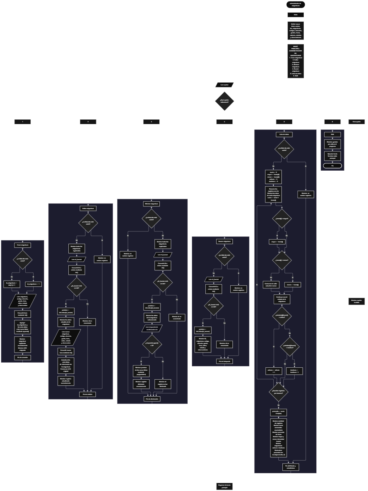

 

Este proyecto, llamado <b>administrador de asignaturas</b>, fue desarrollado en <b>python</b> como un ejercicio práctico para fortalecer la lógica de programación mediante la creación de un sistema de gestión académica desde la consola. El programa cuenta con un menú principal de seis opciones que permite <b>crear, editar, eliminar, buscar y listar asignaturas</b>, además de consultar estadísticas sobre los registros almacenados. Cada asignatura contiene información como el nombre, el código, el docente responsable, el grado, la intensidad horaria semanal, el salón, el estado y las observaciones. Los datos se organizan mediante <b>nueve listas paralelas</b>, incluyendo una lista de identificadores, que mantienen la correspondencia entre los campos de cada registro durante la ejecución. Durante su desarrollo se aplicaron conceptos fundamentales de programación, como variables, listas, estructuras condicionales, ciclos repetitivos, búsqueda por identificadores, modificación y eliminación de registros, acumuladores y cálculos estadísticos. Este proyecto permite poner en práctica los conocimientos adquiridos en python y sirve como base para desarrollar sistemas de gestión académica más avanzados utilizando otros lenguajes y tecnologías.

<h2 align="center">⚙️ Funcionamiento del menú principal</h2>

### ➕ Crear asignatura

La opción <b>1) crear asignatura</b> permite registrar una nueva asignatura en el sistema. Antes de almacenar los datos, el programa comprueba si la lista <b>ids</b> está vacía. Si no existen registros, asigna el identificador <b>1</b> mediante la variable <b>id_asignatura</b>. En caso contrario, genera el siguiente identificador sumando uno al último ID almacenado mediante la expresión <b>ids[-1] + 1</b>. Después, solicita el <b>nombre de la asignatura, código, docente responsable, grado, intensidad horaria, salón, estado y observación</b>. La intensidad horaria se convierte a un número entero utilizando <b>int()</b>. Una vez introducidos los datos, el programa almacena el identificador y los ocho campos de información en sus respectivas listas mediante el método <b>append()</b>. Finalmente, muestra el mensaje <b>"asignatura registrada correctamente."</b> e informa el ID asignado al nuevo registro. La información permanece almacenada en las listas durante la ejecución del programa.

### ✏️ Editar asignatura

La opción <b>2) editar asignatura</b> permite modificar la información de una asignatura registrada. Primero, el programa comprueba si la lista <b>ids</b> está vacía. Si no existen registros, muestra el mensaje <b>"no existen registros."</b>. En caso contrario, utiliza un ciclo <b>for</b> para mostrar las asignaturas almacenadas, incluyendo el ID, nombre, código, docente, grado, horas, salón, estado y observaciones. Después, solicita el identificador del registro que se desea editar mediante la variable <b>id_buscar</b>, convirtiendo el valor introducido a entero con <b>int()</b>. El programa comprueba si el ID se encuentra en la lista <b>ids</b>. Si existe, obtiene su posición mediante <b>ids.index(id_buscar)</b> y muestra los datos actuales de la asignatura seleccionada. A continuación, solicita la nueva información y actualiza las ocho listas correspondientes a los campos de la asignatura, conservando el identificador original. Finalmente, muestra el mensaje <b>"registro actualizado correctamente."</b>. Si el ID no se encuentra, presenta el mensaje <b>"id no encontrada."</b>.

### 🗑️ Eliminar asignatura

La opción <b>3) eliminar asignatura</b> permite eliminar un registro del sistema mediante su identificador. Primero, el programa comprueba si existen asignaturas almacenadas. Si la lista <b>ids</b> está vacía, muestra el mensaje <b>"no existen registros."</b>. Si hay información disponible, presenta todos los registros utilizando un ciclo <b>for</b>. Después, solicita el ID de la asignatura que se desea eliminar y verifica si se encuentra en la lista de identificadores. Cuando el registro existe, obtiene su posición mediante <b>ids.index(id_buscar)</b> y muestra todos los datos de la asignatura seleccionada. Posteriormente, solicita una confirmación mediante la pregunta <b>"¿desea eliminar este registro? (s/n):"</b>. Si la respuesta, convertida a mayúsculas mediante <b>respuesta.upper()</b>, es igual a <b>"S"</b>, el programa elimina la posición correspondiente de las nueve listas utilizando <b>pop(posicion)</b>. Esta operación permite mantener la correspondencia entre los datos de cada asignatura. Finalmente, muestra el mensaje <b>"registro eliminado correctamente."</b>. Si la respuesta no es <b>"S"</b>, informa que el registro no fue eliminado. Si el ID introducido no existe, muestra el mensaje <b>"id no encontrada."</b>.

### 🔎 Buscar asignatura

La opción <b>4) buscar asignatura</b> permite localizar una asignatura registrada mediante su identificador. Antes de realizar la búsqueda, el programa comprueba si existen registros almacenados. Si no hay asignaturas, presenta el mensaje <b>"no existen registros."</b>. En caso contrario, solicita el ID mediante la variable <b>id_buscar</b> y convierte el valor introducido a entero con <b>int()</b>. A continuación, comprueba si el identificador está presente en la lista <b>ids</b>. Si encuentra una coincidencia, utiliza <b>ids.index(id_buscar)</b> para obtener la posición del registro y muestra todos sus datos: identificador, asignatura, código, docente, grado, intensidad horaria, salón, estado y observaciones. Si el identificador no está registrado, muestra el mensaje <b>"id no encontrada."</b>. Esta función permite consultar una asignatura específica sin necesidad de modificar o eliminar sus datos.

### 📋 Lista de datos y estadísticas

La opción <b>5) lista de datos</b> permite visualizar todas las asignaturas registradas y obtener estadísticas generales sobre la información almacenada. Primero, el programa comprueba si la lista <b>ids</b> está vacía. Si no existen registros, muestra el mensaje <b>"no existen registros."</b>. Si hay asignaturas disponibles, inicializa las variables <b>suma</b>, <b>mayor</b>, <b>menor</b>, <b>activas</b> e <b>inactivas</b>. La variable <b>suma</b> comienza en cero, mientras que <b>mayor</b> y <b>menor</b> toman como valor inicial la primera intensidad horaria almacenada en <b>horas[0]</b>. Durante el recorrido de las listas mediante un ciclo <b>for</b>, el programa muestra los datos de cada asignatura, acumula las horas semanales y compara cada valor para identificar la mayor y la menor intensidad horaria. También cuenta las asignaturas cuyo estado coincide con <b>"activa"</b> o <b>"inactiva"</b>, utilizando el método <b>lower()</b> para realizar la comparación sin distinguir entre mayúsculas y minúsculas. Al finalizar el recorrido, calcula el promedio de horas dividiendo la suma entre la cantidad de registros. Finalmente, presenta la cantidad de registros, las horas semanales acumuladas, el promedio de horas, la mayor y menor intensidad horaria, y la cantidad de asignaturas activas e inactivas. El promedio se muestra redondeado a dos decimales mediante <b>round(promedio, 2)</b>.

### 🚪 Salir del menú principal

La opción <b>6) salir</b> permite finalizar la ejecución del programa. Cuando el usuario selecciona esta opción, el sistema muestra el mensaje <b>"gracias por utilizar el programa."</b> y ejecuta la instrucción <b>break</b>, que interrumpe el ciclo principal <b>while True</b>. De esta manera, el programa termina su ejecución después de mostrar el mensaje de despedida. Si el usuario introduce un valor diferente de las opciones disponibles, el bloque <b>else</b> muestra el mensaje <b>"opción inválida."</b>, permitiendo que el menú vuelva a presentarse mientras el ciclo principal continúe activo.

<h2 align="center">🧠 Temas aplicados en el proyecto</h2>

### 📦 Variables

En este proyecto se utilizan variables para controlar la opción seleccionada en el menú, generar identificadores, almacenar temporalmente los datos introducidos por el usuario, localizar registros, confirmar eliminaciones y calcular estadísticas. También se utilizan variables auxiliares para recorrer las listas, determinar la posición de una asignatura y realizar operaciones aritméticas durante el análisis de los datos. Cada variable cumple una función específica dentro de las operaciones del sistema.

🔢 **Opcion:** Almacena la opción seleccionada por el usuario en el menú principal.

🆔 **Id_asignatura:** Almacena el identificador generado para una nueva asignatura.

🔎 **Id_buscar:** Almacena el identificador introducido para localizar una asignatura.

📍 **Posicion:** Representa la posición del registro encontrado en las listas paralelas.

📝 **Asignatura, codigo, docente, grado, hora, salon, estado y observacion:** Almacenan temporalmente los datos introducidos durante el registro de una asignatura.

🔄 **I:** Funciona como variable de recorrido en los ciclos `for` utilizados para mostrar los registros y calcular estadísticas.

✅ **Respuesta:** Almacena la respuesta introducida por el usuario para confirmar o cancelar la eliminación de un registro.

📊 **Suma:** Acumula la intensidad horaria semanal de todas las asignaturas registradas.

⬆️ **Mayor:** Almacena la mayor intensidad horaria encontrada durante el recorrido de los registros.

⬇️ **Menor:** Almacena la menor intensidad horaria encontrada durante el recorrido de los registros.

📈 **Promedio:** Almacena el resultado de dividir la suma de las horas entre la cantidad de asignaturas registradas.

🟢 **Activas:** Cuenta las asignaturas cuyo estado corresponde a <b>"activa"</b>, sin distinguir entre mayúsculas y minúsculas.

🔴 **Inactivas:** Cuenta las asignaturas cuyo estado corresponde a <b>"inactiva"</b>, sin distinguir entre mayúsculas y minúsculas.

### 🗃️ Listas paralelas

En este proyecto se utilizan nueve listas paralelas para organizar los datos de las asignaturas registradas. Cada lista almacena un campo específico y utiliza el mismo índice para relacionar la información correspondiente a un mismo registro. Por ejemplo, los datos de una asignatura ubicada en la posición <b>0</b> se encuentran distribuidos entre <b>ids[0], asignaturas[0], codigos[0], docentes[0], grados[0], horas[0], salones[0], estados[0]</b> y <b>observaciones[0]</b>. Esta organización permite recorrer, buscar, modificar, mostrar y eliminar los registros manteniendo la relación entre sus campos.

🆔 **Ids:** Almacena los identificadores de las asignaturas registradas.

📚 **Asignaturas:** Almacena los nombres de las asignaturas.

🔖 **Codigos:** Almacena los códigos correspondientes a cada asignatura.

👨‍🏫 **Docentes:** Almacena los nombres de los docentes responsables.

🎓 **Grados:** Almacena los grados asociados a las asignaturas.

⏱️ **Horas:** Almacena la intensidad horaria semanal de cada asignatura como un número entero.

🏫 **Salones:** Almacena los salones asignados a las asignaturas.

📌 **Estados:** Almacena el estado registrado para cada asignatura.

📝 **Observaciones:** Almacena las observaciones adicionales de cada registro.

### 🔀 Estructuras condicionales

En este proyecto se utilizan las estructuras condicionales <b>if, elif y else</b> para controlar las operaciones del menú principal y determinar las acciones que debe realizar el programa según las condiciones encontradas. Estas estructuras permiten comprobar si existen registros antes de ejecutar determinadas operaciones, verificar si un identificador está presente en la lista <b>ids</b>, decidir si se debe actualizar o eliminar una asignatura y determinar si la confirmación de eliminación corresponde a la respuesta <b>"S"</b>. También permiten identificar los estados de las asignaturas durante el cálculo de las estadísticas y mostrar el mensaje <b>"opción inválida."</b> cuando la selección no corresponde a ninguna de las opciones disponibles.

### 🔄 Estructuras repetitivas

En este proyecto se utilizan los ciclos <b>while</b> y <b>for</b> para controlar la ejecución del programa y recorrer los registros almacenados. El ciclo <b>while True</b> mantiene activo el menú principal, permitiendo que el usuario realice distintas operaciones hasta seleccionar la opción de salida. Los ciclos <b>for</b> se utilizan para mostrar las asignaturas registradas durante las operaciones de edición y eliminación, así como para recorrer todos los registros durante la generación del listado y el cálculo de las estadísticas. La instrucción <b>break</b> permite interrumpir el ciclo principal cuando se selecciona la opción <b>6) salir</b>.

### 🎯 Estructuras de selección

El programa utiliza una cadena de condiciones <b>if, elif y else</b> para evaluar el contenido de la variable <b>opcion</b> y ejecutar la operación correspondiente. Cada condición representa una de las seis opciones del menú principal: crear, editar, eliminar, buscar, listar datos o salir. El bloque <b>else</b> se ejecuta cuando el valor introducido no coincide con ninguna de las opciones definidas y muestra el mensaje <b>"opción inválida."</b>. Esta organización permite mantener las distintas funcionalidades del programa separadas y facilita la lectura de su estructura.

### 🔍 Búsqueda por identificadores

La búsqueda de registros se realiza utilizando la lista <b>ids</b> y los métodos <b>in</b> e <b>index()</b>. Primero, el programa comprueba si el identificador introducido está presente en la lista. Si existe, utiliza <b>ids.index(id_buscar)</b> para obtener la posición correspondiente y acceder a los datos relacionados en las demás listas paralelas. Este procedimiento se aplica en las operaciones de edición, eliminación y búsqueda de asignaturas, permitiendo identificar el registro que debe consultarse o modificarse.

### 🧮 Acumuladores y cálculos estadísticos

El programa utiliza acumuladores, comparaciones y operaciones aritméticas para obtener estadísticas sobre las asignaturas registradas. La variable <b>suma</b> acumula las horas semanales mediante la expresión <b>suma += horas[i]</b>. Las variables <b>mayor</b> y <b>menor</b> se actualizan mediante condiciones que comparan cada intensidad horaria con los valores registrados hasta ese momento. La variable <b>promedio</b> se calcula dividiendo la suma entre el número total de registros. Además, las variables <b>activas</b> e <b>inactivas</b> funcionan como contadores que aumentan cuando el estado de una asignatura coincide con los valores correspondientes. Estos procedimientos permiten obtener un resumen de la distribución de las intensidades horarias y los estados registrados.

### 🔢 Conversión de tipos de datos

En el programa se utiliza la función <b>int()</b> para convertir a números enteros la intensidad horaria introducida al registrar o editar una asignatura, así como el identificador proporcionado durante las operaciones de edición, eliminación y búsqueda. Esta conversión permite realizar comparaciones numéricas y almacenar las horas semanales como valores enteros. Sin embargo, el código no incluye un bloque <b>try/except</b> para gestionar las entradas que no puedan convertirse a enteros, por lo que un valor no numérico puede interrumpir la ejecución del programa.

### 🔄 Gestión de registros mediante listas

La administración de los registros se realiza mediante los métodos <b>append()</b> e <b>pop()</b>, además de la asignación directa a las posiciones de las listas. Durante la creación, <b>append()</b> agrega el identificador y los datos de la nueva asignatura. Durante la edición, el programa reemplaza los valores almacenados en las posiciones correspondientes, conservando el identificador original. Durante la eliminación, <b>pop(posicion)</b> retira el elemento de la posición seleccionada en cada una de las nueve listas. Esta organización permite mantener alineados los campos de cada asignatura durante las operaciones de gestión.

<h2 align="center">¿Cómo se implementaron las operaciones crud en el proyecto?</h2>

Las operaciones <b>crud</b> se implementaron mediante las opciones del menú principal para administrar las asignaturas registradas. La operación <b>crear</b> corresponde a <b>crear asignatura</b>, donde se genera un identificador y se almacenan los datos en las listas paralelas; <b>leer</b> se realiza mediante las opciones <b>buscar asignatura y lista de datos</b>, que permiten consultar registros individuales o visualizar todas las asignaturas junto con sus estadísticas; <b>actualizar</b> corresponde a <b>editar asignatura</b>, donde se reemplazan los datos de una asignatura existente sin modificar su ID; y <b>eliminar</b> se realiza mediante la opción <b>eliminar asignatura</b>, que solicita confirmación antes de retirar el registro de las listas. Estas operaciones utilizan estructuras condicionales, ciclos, identificadores y métodos de listas para administrar la información temporalmente durante la ejecución del programa.

<h2 align="center">Diagrama de flujo del proyecto</h2>

<h2 align="center">🛡️ Validaciones del programa</h2>

### 📭 No existen registros

Esta comprobación se utiliza en las opciones de <b>editar, eliminar, buscar y lista de datos</b>. Antes de continuar, el programa comprueba si la lista <b>ids</b> está vacía mediante la condición <b>len(ids) == 0</b>. Si no existen asignaturas registradas, muestra el mensaje <b>"no existen registros."</b> y evita continuar con la operación seleccionada. Esta comprobación permite controlar las operaciones que necesitan información almacenada previamente.

### 🔎 Identificador no encontrado

Esta comprobación se utiliza en las opciones de <b>editar, eliminar y buscar asignatura</b>. Después de solicitar el identificador, el programa comprueba si el valor de <b>id_buscar</b> se encuentra en la lista <b>ids</b>. Si existe, obtiene la posición mediante <b>ids.index(id_buscar)</b> y continúa con la operación correspondiente. Si no existe, muestra el mensaje <b>"id no encontrada."</b>. Esta comprobación permite evitar el acceso a posiciones asociadas a identificadores que no están registrados.

### ⚠️ Confirmación de eliminación

Esta comprobación se utiliza durante la eliminación de una asignatura. Después de mostrar los datos del registro seleccionado, el programa solicita una respuesta mediante la variable <b>respuesta</b>. La condición <b>respuesta.upper() == "S"</b> permite confirmar la eliminación utilizando la letra <b>s</b> o <b>S</b>. Si se cumple la condición, elimina los elementos de las nueve listas mediante <b>pop(posicion)</b> y muestra el mensaje <b>"registro eliminado correctamente."</b>. Si la respuesta es diferente de <b>"S"</b>, muestra el mensaje <b>"el registro no fue eliminado."</b>.

### 🔢 Conversión de datos numéricos

El programa utiliza <b>int()</b> para convertir las entradas correspondientes a los identificadores y la intensidad horaria semanal. Esta operación permite trabajar con valores enteros en las búsquedas y en los cálculos estadísticos. Sin embargo, no se incluye una validación mediante <b>try/except</b> para controlar los errores de conversión. Por ello, si el usuario introduce un valor que no puede convertirse a entero, el programa puede finalizar con un error durante la ejecución.

### 📌 Clasificación de estados

Durante el cálculo de las estadísticas, el programa utiliza las condiciones <b>estados[i].lower() == "activa"</b> y <b>estados[i].lower() == "inactiva"</b> para contar los registros según su estado. El método <b>lower()</b> permite reconocer estas palabras independientemente del uso de mayúsculas y minúsculas. No obstante, el programa no restringe los valores que pueden introducirse en el campo de estado, por lo que los registros con otros valores no se contabilizan como activos ni como inactivos.

### ⚠️ Opción inválida

El menú principal utiliza una estructura condicional <b>if, elif y else</b> para identificar la opción seleccionada. Si el usuario introduce un valor diferente de <b>1, 2, 3, 4, 5 o 6</b>, se ejecuta el bloque <b>else</b> y se muestra el mensaje <b>"opción inválida."</b>. Después, el ciclo <b>while True</b> permite presentar nuevamente el menú para que el usuario pueda seleccionar otra opción.

<h2 align="center">🎯 Objetivo del proyecto</h2>

El objetivo principal de este proyecto es fortalecer la <b>lógica de programación</b> mediante el desarrollo de un sistema de gestión de asignaturas en <b>python</b>. A través de su construcción se busca aplicar los conocimientos adquiridos sobre variables, listas paralelas, estructuras condicionales, ciclos repetitivos, búsqueda por identificadores, modificación y eliminación de registros, acumuladores y cálculos estadísticos. Además, el proyecto permite comprender cómo organizar y administrar información académica en una aplicación de consola, mantener la correspondencia entre diferentes campos de un registro y obtener estadísticas a partir de los datos almacenados. De esta manera, establece una base para desarrollar sistemas de gestión académica más completos utilizando otros lenguajes y tecnologías.

